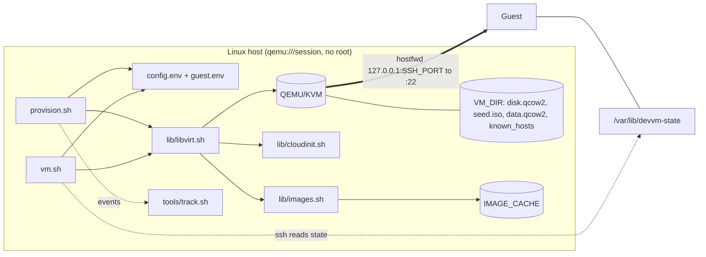
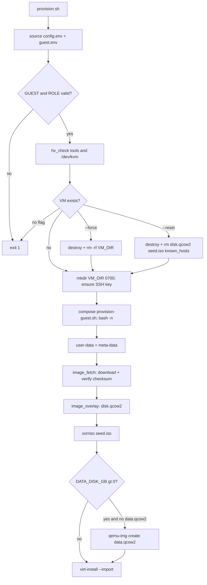
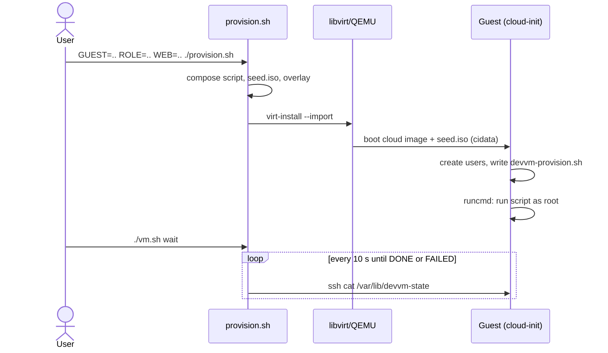
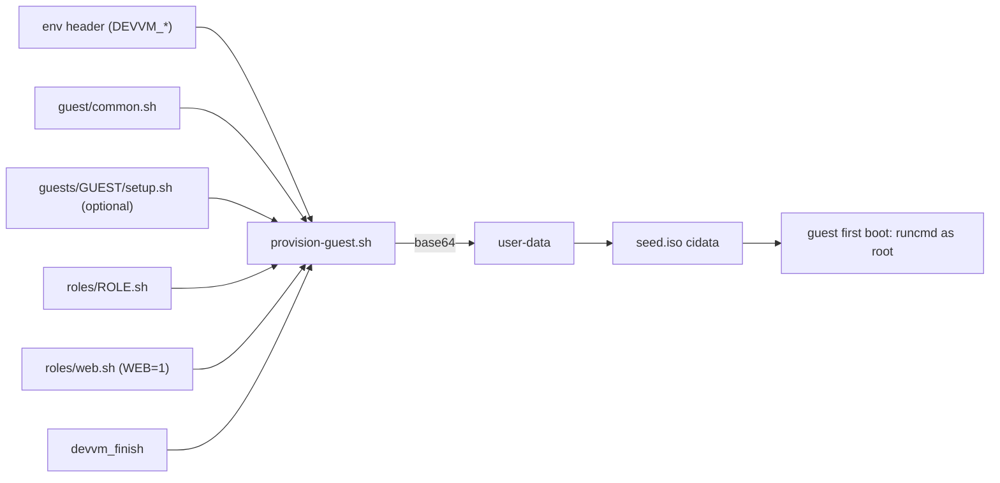
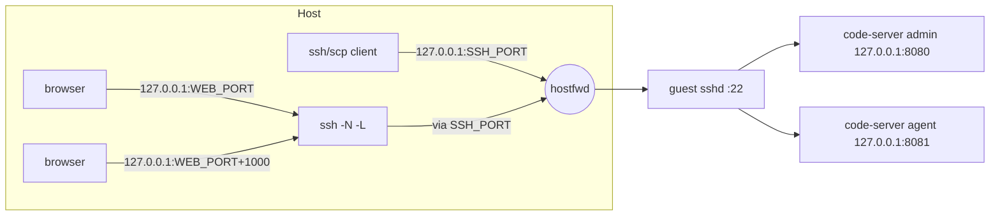
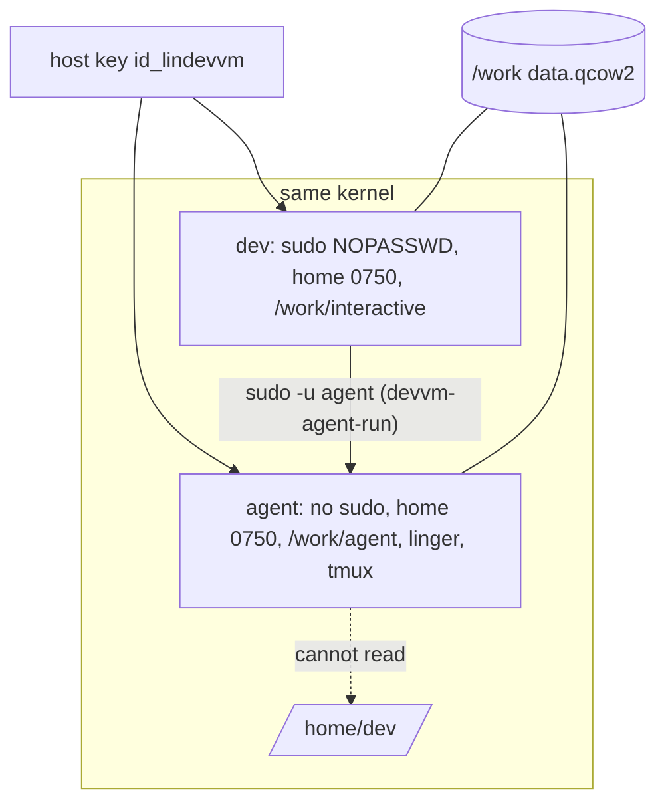
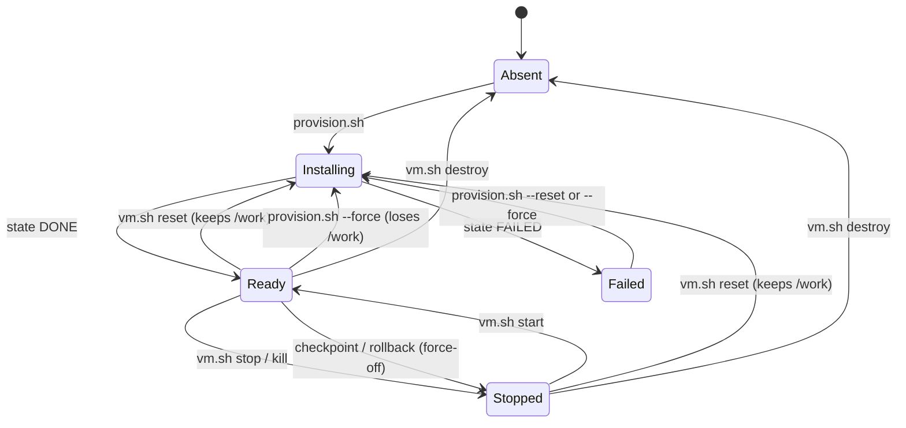

# Architecture

## Contents

- [Layers](#layers)
- [Provisioning flow](#provisioning-flow)
- [Cloud-init composition](#cloud-init-composition)
- [State file protocol](#state-file-protocol)
- [Disks](#disks)
- [Networking and port derivation](#networking-and-port-derivation)
- [Two-user isolation](#two-user-isolation)
- [Web tunnel](#web-tunnel)
- [VM lifecycle](#vm-lifecycle)
- [Tracker](#tracker)

ASCII versions of the main diagrams: [diagrams/ascii_architecture.txt](diagrams/ascii_architecture.txt).

## Layers

| Layer | Files | Responsibility |
|---|---|---|
| Entry points | `provision.sh`, `vm.sh` | Create/rebuild a VM; day-2 operations. |
| Configuration | `config.env`, `guests/<g>/guest.env` | Defaults, validation, derived values (ports, MAC, sizes). Env overrides win. |
| Host libraries | `lib/common.sh`, `lib/images.sh`, `lib/cloudinit.sh`, `lib/libvirt.sh` | Slot/MAC math; cached checksum-verified images and qcow2 overlays; NoCloud seed; libvirt/virt-install backend. |
| Guest scripts | `guest/common.sh`, `guests/<g>/setup.sh`, `roles/{dev,ai,web}.sh` | Run once as root inside the guest. Concatenated into one script. |
| Tooling | `tools/track.sh`, `tools/tracker/`, `tests/` | Progress dashboard; offline test suites. |



## Provisioning flow

`provision.sh [--force|--reset]`:

1. Sources `config.env` (which sources `guests/$GUEST/guest.env`). Exits 1 on unknown `GUEST` or `ROLE`.
2. `hv_check`: requires `virt-install virsh xorriso qemu-img curl ssh-keygen` and read/write on `/dev/kvm`.
3. If the domain exists: `--force` destroys/undefines it and removes `$VM_DIR`; `--reset` destroys/undefines
   it and removes only `disk.qcow2`, `seed.iso`, `known_hosts`; otherwise exit 1.
4. Creates `$VM_DIR` (mode 0700) and, if missing, the ed25519 key `$SSH_KEY`.
5. Composes the in-guest script and runs `bash -n` on it.
6. Writes `user-data`/`meta-data` (`lib/cloudinit.sh`), emits tracker events, calls `hv_create`.
7. Prints a banner; the guest keeps provisioning in the background.





## Cloud-init composition

`provision.sh` builds `$STAGE/provision-guest.sh` as, in order:

1. `#!/usr/bin/env bash` and one `export DEVVM_<NAME>=<value>` per variable in
   `GUEST GUEST_FAMILY ROLE WEB ADMIN_USER AGENT_USER WEB_PASS WEB_PORT_GUEST DESKTOP DESKTOP_ENV DATA_DISK_GB VM_NAME`.
   Nothing else from the host environment reaches the guest (for example `OMARCHY_REF` set on the host
   is not forwarded).
2. `guest/common.sh`: helpers, state file, then `devvm_base` (hostname, package index, SSH hardening,
   qemu-guest-agent).
3. `guests/$GUEST/setup.sh` if it exists (only `kubuntu` and `omarchy`; both act only when `DEVVM_DESKTOP=1`).
4. `roles/$ROLE.sh`.
5. `roles/web.sh` if `WEB=1`.
6. `devvm_finish`.

`lib/cloudinit.sh` then writes a `#cloud-config`: the admin user (`sudo: ALL=(ALL) NOPASSWD:ALL`) plus, for
`ROLE=ai`, the agent user (no sudo); both `lock_passwd: true` with the host public key; `ssh_pwauth: false`;
the script base64-encoded into `/usr/local/sbin/devvm-provision.sh` (0700); and a `runcmd` that runs it with
output appended to `/var/log/devvm-provision.log`. `meta-data` carries `instance-id: <VM_NAME>-<epoch>`
(new on every provision, so cloud-init treats each rebuild as a first boot) and the hostname.
`ci_make_seed` packs both into an ISO labelled `cidata`.



Package manager abstraction (`pkg_update`, `pkg_install`, `pkg_try`, `retry`) is selected by
`GUEST_FAMILY`: `debian` (apt), `rhel` (dnf), `arch` (pacman), `suse` (zypper).

## State file protocol

The guest script is the only writer of `/var/lib/devvm-state` (mode 644):

| Content | Meaning | Written by |
|---|---|---|
| (file absent) | host reports `installing` | `vm.sh state` fallback |
| `installing: <step>` | in progress | `devvm_step` |
| `DONE` | finished; also creates `/var/lib/devvm-ready` | `devvm_finish` |
| `FAILED: <step> (line N)` | `ERR` trap or explicit failure; the script exits 1 | `devvm_fail` |

`vm.sh wait` polls over SSH every 10 s (`WAIT_TIMEOUT`, default 3600 s): exit 0 on `DONE*`, exit 1 on
`FAILED*` or timeout. Non-fatal problems use `devvm_warn` and do not change the state. The
`ERR` trap makes most unguarded command failures fatal.

## Disks

| File (in `$VM_DIR`) | Kind | Lifetime |
|---|---|---|
| `disk.qcow2` | qcow2 overlay (backing file = cached image in `IMAGE_CACHE`), virtual size `VM_DISK_GB` | Disposable; rebuilt by `reset`. Deleting the cached base breaks it. |
| `seed.iso` | NoCloud seed, SATA CD-ROM | Rebuilt on every provision. |
| `data.qcow2` | blank qcow2, `DATA_DISK_GB`, virtio serial `devvm-data` | Created once, kept by `--reset`, deleted by `--force`/`destroy`. |
| `known_hosts` | per-VM SSH host keys | Removed by `--reset` (host key changes). |

In the guest, `devvm_mount_work` waits up to 30 s for `/dev/disk/by-id/virtio-devvm-data`, runs
`mkfs.ext4 -L work` only if `blkid` finds no filesystem, adds `LABEL=work /work ext4 defaults,nofail 0 2`
to fstab and mounts it. This is why a `reset` re-attaches existing data without reformatting.

## Networking and port derivation

`virt-install` is run with `--network none` and a hand-written `-netdev user` NIC carrying
`hostfwd=tcp:127.0.0.1:$SSH_PORT-:22`. There is no bridge and no inbound path except that forward.

```
vm_slot(name) = cksum(name) mod 899        (0..898)
SSH_PORT      = 2300  + slot               host 127.0.0.1 -> guest :22
WEB_PORT      = 18080 + slot               vm.sh web, admin IDE
agent web     = WEB_PORT + 1000            vm.sh web, ROLE=ai only
MAC           = 52:54:00:<slot%256>:<slot/256>:<cksum%256>
```

Example: `lin-ubuntu-ai` gives slot 132, so SSH 2432, web 18212, agent web 19212. Distinct names can in
principle hash to the same slot; override `SSH_PORT`/`WEB_PORT`/`VM_MAC` if so. `VM_NAME` defaults to
`lin-$GUEST-$ROLE`, so use the same `GUEST/ROLE/VM_NAME` for `vm.sh` as for `provision.sh`.



## Two-user isolation

Only with `ROLE=ai` (`roles/ai.sh`):

- `dev` (`ADMIN_USER`): cloud-init user with NOPASSWD sudo; `/work/interactive`, `~/work` symlink.
- `agent` (`AGENT_USER`): created by cloud-init (shell, key) and finished by the role; no sudo (removed from
  `sudo`/`wheel`, sudoers drop-in deleted), removed from the admin's group; `/work/agent`, `~/work` symlink.
- Both homes `0750`; `/work` `0755`; `/work/agent` and `/work/interactive` `0750` to their owners.
- Agent toolchain, installed per user: Node 22 tarball (nodejs.org, `latest-v22.x`) in `~/.local/node` with
  `NPM_CONFIG_PREFIX=~/.npm-global` (fallback: distro `nodejs npm`), `@anthropic-ai/claude-code`, `uv`.
  `~/.devvm-env` is sourced from `.profile`/`.bashrc`. `loginctl enable-linger` keeps tmux alive after logout.
- `/usr/local/bin/devvm-agent-run [-n name] [-m mem] [-c cpu] -- cmd...`: if invoked by another user it
  re-execs via `sudo -n -u agent`; then starts a detached tmux session in `/work/agent` inside a
  `systemd-run --user --scope -p MemoryMax -p CPUQuota` (defaults `8G`, `400%`).
- `/etc/devvm/devvm-agent@.service.example`: a stricter systemd unit, **not enabled**.



## Web tunnel

`roles/web.sh` (when `WEB=1`): installs code-server (vendor install script, fallback GitHub release
tarball into `/usr/local/lib/code-server-<ver>`), writes its own `code-server@.service`, writes per-user
`config.yaml` (`bind-addr: 127.0.0.1:<port>`, `auth: password`, `cert: false`), enables
`code-server@<admin>` on `WEB_PORT_GUEST` (8080) and for `ROLE=ai` also `code-server@<agent>` on 8081, then
asserts with `ss` that the listeners are loopback-only (otherwise `devvm_fail`). If code-server cannot be
installed the web step is skipped with a warning. `vm.sh web` runs
`ssh -N -L 127.0.0.1:WEB_PORT:127.0.0.1:WEB_PORT_GUEST` (plus the `+1000 -> +1` pair for `ROLE=ai`) and
stays in the foreground until Ctrl-C.

## VM lifecycle



`vm.sh reset` is `exec provision.sh --reset`. `checkpoint`/`rollback` force the VM off and use
`qemu-img snapshot -c/-a` on `disk.qcow2` only; leave the VM stopped. `data.qcow2` is never snapshotted.

## Tracker

`tools/track.sh event <agent> <state> <msg> [pct]` appends a JSON line to
`.tracker/events/<agent>.jsonl`. `provision.sh` emits `provision start` and `provision created` (errors
ignored). `tools/tracker/server.mjs` (Node, default `127.0.0.1:4790`) serves a page plus `/api/state` and
an SSE `/api/stream`, combining events, `.tracker/plan.json`, `.tracker/tests.json` (written by
`tests/run.sh`), the guest list from `guests/*/guest.env`, live `lin-*` domains from
`virsh -c qemu:///session list --all`, and git state. Details: [running.md](running.md),
[how-to.md](how-to.md#use-the-tracker).
